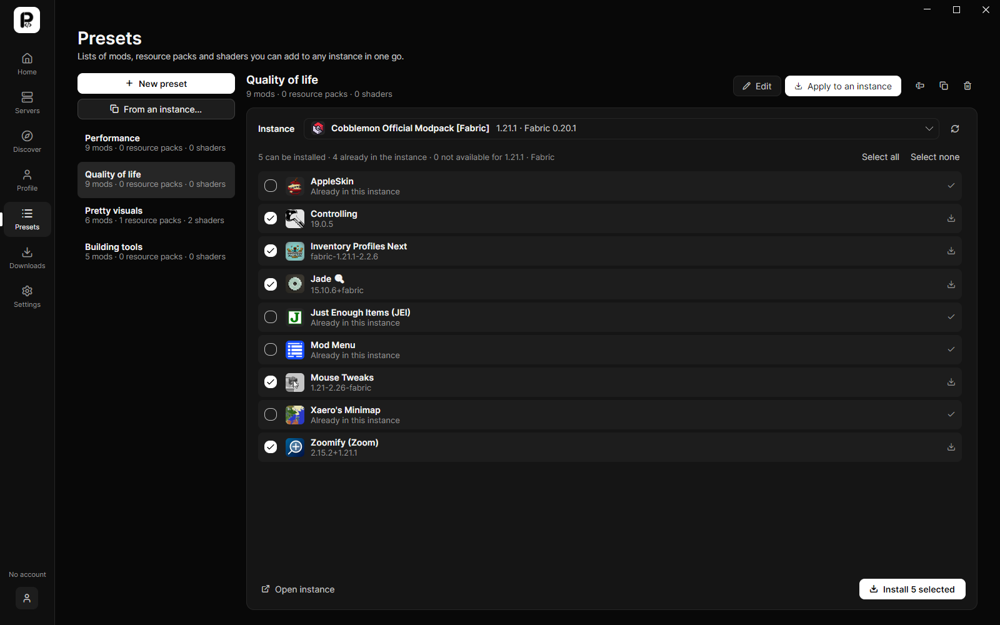

<div align="center">


# PyroLauncher

A custom launcher for people who play with mods (PyroLauncher is not an official Minecraft product and is not approved by or associated with
Mojang or Microsoft)

[](LICENSE)
[](https://dotnet.microsoft.com/)
[](#requirements)
[](https://github.com/PyroByteTeam/PyroLauncher/releases/latest)


</div>

## Why another launcher

I am LynxarA, the creator of this project. The main reason behind it was to build something that doesn't stop at basic features, while also not being a web app and actually performing well. I am not trying to reach the blazingly fast speeds of vanilla launchers, but I think lag during navigation and loading is unacceptable (no guarantees, though).

The main philosophy behind this launcher, and other popular custom launchers - is to treat every Minecraft instance as a modpack, even if you play vanilla (in which case, it's just a modpack without mods). I find this approach the most optimal, since most of the player base uses Vanilla+ mods at a minimum (in my observation). However, after creating multiple modpacks, I realized that the most popular launchers don't really implement features for power users (and I consider anyone who constantly iterates on 300+ mod packs, updates them, and shares them with friends to be a power user).

So, here is a launcher with all the features I want (mhm, bloat, crucify me), without nuking your PC before you even add an instance.

## What it does

**Instances.** Vanilla, Fabric, Forge or NeoForge, each with its own folder, settings and
play time (nothing special there). Group them into categories by dragging cards around. A new instance shows an
**Install** button first, which downloads the game, mod loader and Java without launching.

**Mods, resource packs and shaders.** Search Modrinth and CurseForge side by side, read
descriptions, galleries and changelogs, pick a version, and install with dependencies. Files
you already have are recognised by hash, so updates work for mods you dropped in by hand.
Turn resource packs on and pick a shader pack before you start the game (or don't :3).
You can easilly update mods, filter them by update availability and much more!

**Modpacks.** Browse packs on the Discover page, install one as a new instance, and update or
roll it back later from its Modpack tab. Your worlds, screenshots and anything you added
yourself are left alone. Import `.mrpack` and CurseForge `.zip` files, or download a pack's
server files.

<p align="center">
  
  
</p>

**Export.** Share an instance as a Modrinth pack, a CurseForge pack or a `.pyropack`
(everything bundled, including the instance's game settings). You choose which files go in.

**Presets.** Save a list of mods, resource packs and shaders once and apply it to any
instance. The launcher finds versions that fit that instance's Minecraft version and loader,
tells you what is missing, and lets you untick anything before installing.

**Java.** Eclipse Temurin builds from Adoptium are downloaded on demand, one per major version,
and the right one is picked for each Minecraft version. Bring your own if you prefer.

**Accounts.** Microsoft sign-in with several accounts, a 3D skin preview, skin upload and cape
switching. Currently we are awaiting verification, so login doesn't work properly.

**Everything else.** Screenshot and server-list managers.
A downloads page with pause, cancel and a list of every domain the launcher talked to. English
and Russian interface (for now). And much more (more features coming)

<p align="center">
  
</p>

### AI usage

Large parts of this codebase were written with the help of Claude Code (using the Opus 5.5 model),
alongside code written directly by humans. Nothing is blindly merged. Every generated file and
change goes through a thorough audit by the PyroByte team, where we read through the code, test
it, and edit it by hand before it makes it into the project.

## Requirements

- Windows 10 or 11, x64 or ARM64
- Nothing else: the installer ships its own .NET runtime, and Java is downloaded when needed

macOS and Linux aren't supported yet. The interface is built on WPF, which is Windows-only.
Currently we are working on migration to Avalonia UI and Core to be able to ship it to macos/linux too!

## Installing

Grab `PyroLauncher-Setup-<version>-win-x64.exe` (or `win-arm64`) from
[Releases](https://github.com/PyroByteTeam/PyroLauncher/releases) and run it. There's also a
portable zip if you'd rather not install anything. It installs for
your user only, so no administrator prompt. Running the same setup again updates or repairs
the install, and it also handles uninstalling. You choose whether to keep your instances and
settings.

Launcher data lives in `%APPDATA%\PyroLauncher`. Set `PYROLAUNCHER_HOME` to keep it somewhere
else, e.g. on another drive or next to a portable copy.

## Building from source

You need the [.NET 10 SDK](https://dotnet.microsoft.com/download).

```powershell
git clone https://github.com/PyroByteTeam/PyroLauncher.git
cd PyroLauncher
dotnet run --project src/PyroLauncher
```

To build release files:

```powershell
.\build-installer.ps1                     # x64 and ARM64
.\build-installer.ps1 -Runtime win-x64    # just one
```

For each runtime you get a setup (`PyroLauncher-Setup-<version>-<runtime>.exe`) and a portable
zip (`PyroLauncher-<version>-<runtime>-portable.zip`) in `artifacts/`. Both are self-contained.

### CurseForge

CurseForge's API needs a key. Get one for free at
[console.curseforge.com](https://console.curseforge.com/) and paste it into
**Settings → Launcher**. Without it everything still works, just with Modrinth only.

## Project layout

```
src/
  PyroLauncher/              the launcher (WPF)
    Accounts/                Microsoft sign-in, profiles, skins
    Content/                 Modrinth & CurseForge APIs, modpacks, presets, export
    Minecraft/               version resolving, loaders, Java, launching
    Instances/               instance model and storage
    UI/                      views, view models, controls, translations
    Lang/                    translation files
  PyroLauncher.Installer/    the setup / uninstaller
```

Adding a language means adding `Lang/<code>.json` (English text → translation) and listing it
in `UI/Loc.cs`. Anything without a translation falls back to English.

## Contributing

Bug reports and pull requests are welcome. For anything bigger than a fix, open an issue first
so we can agree on the approach. Please keep changes focused and test them against a real
game launch.

## License

[GPL-3.0](LICENSE). Made by the PyroByte team.

PyroLauncher is not an official Minecraft product and is not approved by or associated with
Mojang or Microsoft.
