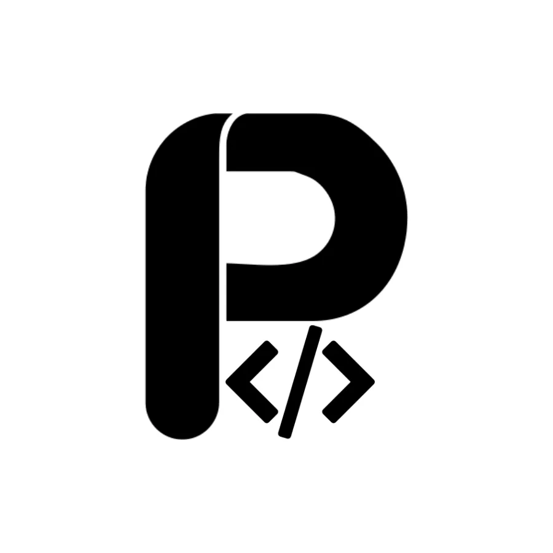
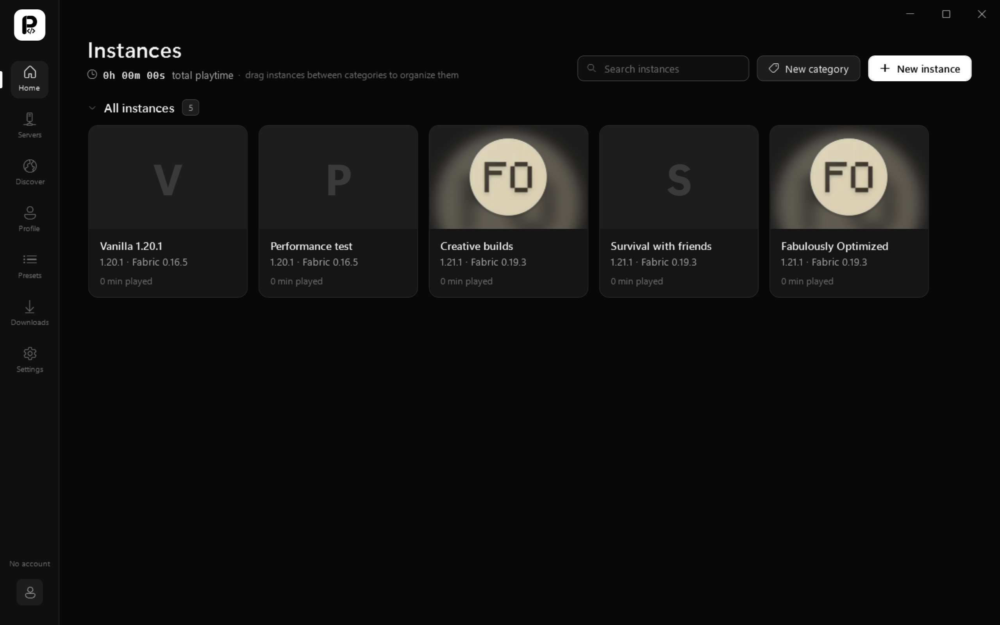
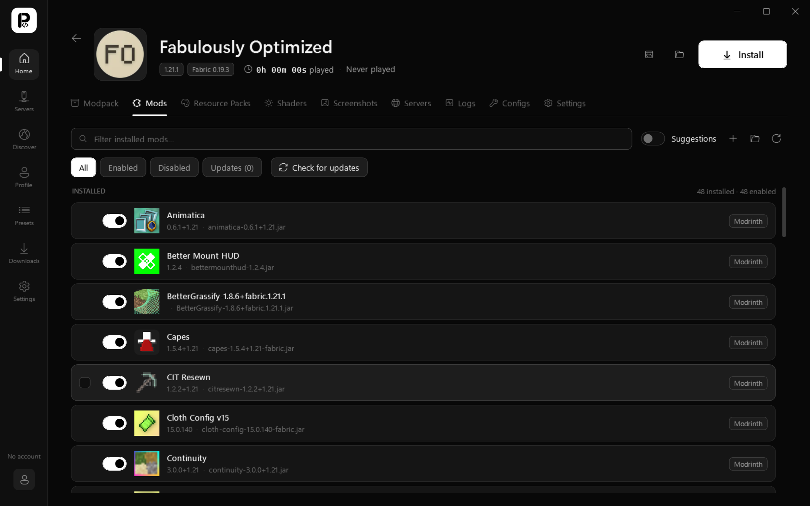
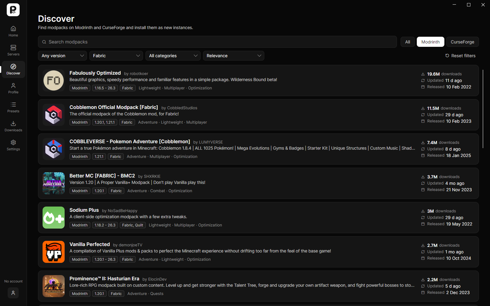
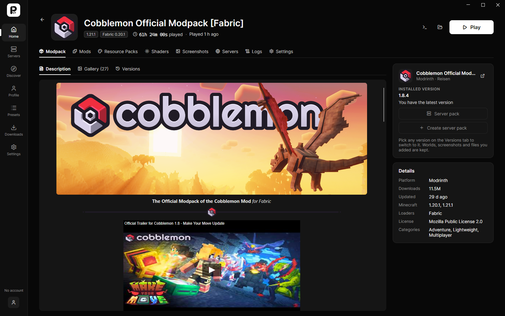

<div align="center">



# PyroLauncher

A custom launcher for people who play with mods (PyroLauncher is not an official Minecraft product and is not approved by or associated with
Mojang or Microsoft)

[](LICENSE)
[](https://dotnet.microsoft.com/)
[](#requirements)
[](https://github.com/PyroByteTeam/PyroLauncher/releases/latest)

**[Website](https://launcher.pyrobyte.top/)** · **[Roadmap](https://launcher.pyrobyte.top/roadmap)**



</div>

## Why another launcher

I am LynxarA, the creator of this project. The main reason behind it was to build something that doesn't stop at basic features, while also not being a web app and actually performing well. I am not trying to reach the blazingly fast speeds of vanilla launchers, but I think lag during navigation and loading is unacceptable (no guarantees, though).

The main philosophy behind this launcher, and other popular custom launchers - is to treat every Minecraft instance as a modpack, even if you play vanilla (in which case, it's just a modpack without mods). I find this approach the most optimal, since most of the player base uses Vanilla+ mods at a minimum (in my observation). However, after creating multiple modpacks, I realized that the most popular launchers don't really implement features for power users (and I consider anyone who constantly iterates on 300+ mod packs, updates them, and shares them with friends to be a power user).

So, here is a launcher with all the features I want (mhm, bloat, crucify me), without nuking your PC before you even add an instance.

## What it does

**Instances.** Vanilla, Fabric, Forge or NeoForge, each with its own folder, settings and
play time (nothing special there). Group them into categories by dragging cards around. A new instance shows an
**Install** button first, which downloads the game, mod loader and Java without launching.

**Mods, resource packs and shaders.** Search Modrinth and CurseForge side by side, read
descriptions, galleries and changelogs, pick a version, and install with dependencies. Files
you already have are recognised by hash, so updates work for mods you dropped in by hand.
Turn resource packs on and pick a shader pack before you start the game (or don't :3).
Check every mod for updates in one click, update them one by one or all at once, and filter
the list by what's enabled, disabled or out of date.

<p align="center">
  
</p>

**Modpacks.** Browse packs on the Discover page, install one as a new instance, and update or
roll it back later from its Modpack tab. Your worlds, screenshots and anything you added
yourself are left alone. Import `.mrpack` and CurseForge `.zip` files, or download a pack's
server files.

<p align="center">
  
  
</p>

**Export.** Share an instance as a Modrinth pack, a CurseForge pack or a `.pyropack`
(everything bundled, including the instance's game settings). You choose which files go in.

**Presets.** Save a list of mods, resource packs and shaders once and apply it to any
instance. The launcher finds versions that fit that instance's Minecraft version and loader,
tells you what is missing, and lets you untick anything before installing.

**Java.** Eclipse Temurin builds from Adoptium are downloaded on demand, one per major version,
and the right one is picked for each Minecraft version. Bring your own if you prefer.

**Accounts.** Microsoft sign-in with several accounts, a 3D skin preview, skin upload and cape
switching. 

**Server packs.** Turn an instance into a server: pick which mods go along (client-only ones are
spotted and left out), and the launcher installs the server, its loader and Java. Each server
gets a panel with live CPU, memory and player count, a console with command completion, a
form for every `server.properties` setting, and player management (whitelist, ops, bans). A
modpack's published server files can be turned into a server pack in one click, and linked
instances get a start/stop button right next to Play.

**LAN over the internet (beta).** Open a single-player world to LAN, start a lobby, and send
friends an invite code: your world shows up under *LAN worlds* in their Minecraft, as if you
were on the same network. Players connect directly to the host, with no server in between, and
everything is encrypted. See [Playing over LAN](#playing-over-lan).

**Everything else.** Screenshot and server-list managers.
A downloads page with pause, cancel and a list of every domain the launcher talked to. English
and Russian interface (for now). And much more (more features coming).

<p align="center">
  
</p>

### AI usage

Large parts of this codebase were written with the help of Claude Code (using the Opus 5.5 model),
alongside code written directly by humans. Nothing is blindly merged. Every generated file and
change goes through a thorough audit by the PyroByte team, where we read through the code, test
it, and edit it by hand before it makes it into the project.

## Requirements

- Windows 10 or 11, macOS 12 or newer, or a desktop Linux (x64 or ARM64 for all three)
- Nothing else: every build ships its own .NET runtime, and Java is downloaded when needed

## Installing

Everything is on the [Releases](https://github.com/PyroByteTeam/PyroLauncher/releases) page.

**Windows** - run `PyroLauncher-Setup-<version>-win-x64.exe` (or `win-arm64`). It installs for
your user only, so no administrator prompt. Running the same setup again updates or repairs
the install, and it also handles uninstalling. You choose whether to keep your instances and
settings. There's also a portable zip if you'd rather not install anything.

**macOS** - open `PyroLauncher-<version>-osx-arm64.dmg` (`osx-x64` for Intel Macs) and drag
`PyroLauncher.app` onto Applications. A plain `.zip` of the app is there too. The app isn't
notarized, so the first time macOS will refuse to open it. Clear the quarantine flag once and it
opens normally:

```sh
xattr -cr /Applications/PyroLauncher.app
```

If it still won't start on Apple Silicon, give it an ad-hoc signature:
`codesign --force --deep --sign - /Applications/PyroLauncher.app`.

**Linux** - pick whichever suits your distro (all of them come in `x64` and `arm64`):

- `.deb` for Debian, Ubuntu, Mint and friends: `sudo apt install ./PyroLauncher-<version>-linux-x64.deb`
- `.rpm` for Fedora, openSUSE and friends: `sudo dnf install ./PyroLauncher-<version>-linux-x64.rpm`
- `.AppImage` for anything else: `chmod +x` it and run it
- `.tar.gz` if you just want the files: extract anywhere and run `./PyroLauncher`

The `.deb` and `.rpm` install to `/opt/pyrolauncher`, add a `pyrolauncher` command and a menu entry.

Launcher data lives in `%APPDATA%\PyroLauncher` on Windows,
`~/Library/Application Support/PyroLauncher` on macOS and `~/.local/share/PyroLauncher` on Linux.
Set `PYROLAUNCHER_HOME` to keep it somewhere else, e.g. on another drive or next to a portable copy.

## Playing over LAN

The **LAN** page lets friends join your single-player world over the internet. It is off by
default: while it's off the launcher opens no ports and contacts nobody for LAN. Turn it on from
the LAN page (you'll be asked to read a short note about IP addresses first).

**Hosting**

1. Start Minecraft from any instance and load a single-player world.
2. Press Esc → **Open to LAN** → **Start LAN World**.
3. In the launcher, choose **Host a lobby** → **Start lobby**. The world is detected
   automatically. If it isn't (some firewalls and VPNs get in the way), type the port Minecraft
   printed in chat ("Local game hosted on port …").
4. Copy the invite code and send it privately to your friends, along with the password if you set one.

When Windows Firewall asks about PyroLauncher, allow it, or nobody can connect.

**Joining**

1. Choose **Join a lobby**, paste the invite code and press **Join**.
   **Test connection** checks that the lobby is reachable and measures ping without joining.
2. Start Minecraft with the same game version and mods as the host.
3. Open **Multiplayer**: the host's world appears at the bottom under *LAN worlds*. If it
   doesn't, use **Direct Connection** with the `127.0.0.1:<port>` address shown on the lobby
   page. Don't type the host's IP address into Minecraft.

**How friends reach you.** Everything (lobby control, tests and game traffic) goes through a
single TCP port on the host, `25570` by default. The launcher asks your router to forward it
with UPnP; if that fails, forward it by hand, or let friends with IPv6 connect directly. When
neither side can open a port, turn on **hole punching**: a friend who can't connect gets a
reply code to send you, and once you paste it the two of you connect over UDP. It doesn't work
with every router (symmetric NAT in particular), and the lobby page warns you when it probably
won't. The address used for hole punching is hidden on the lobby page so it doesn't show up on
stream; a button next to it copies it.

**Managing a lobby.** The host sees every player with their ping, and can kick and ban them
(bans apply to every lobby you host). Join, leave and timeout messages show in the launcher
and, if you turn on system notifications in **Settings**, from your OS while you're playing.

**Privacy and security.** There is no relay server, so the host sees the IP address of everyone
who joins, and everyone who joins sees the host's (it's inside the invite code). Only play with
people you trust and don't post invite codes publicly. Every connection is end-to-end encrypted
(ECDH key exchange, AES-256-GCM), and the invite code contains the host's key fingerprint so
players can tell they reached you and not an impersonator.

## Building from source

You need the [.NET 10 SDK](https://dotnet.microsoft.com/download).

```sh
git clone https://github.com/PyroByteTeam/PyroLauncher.git
cd PyroLauncher
dotnet run --project src/PyroLauncher.Desktop
```

The interface is [Avalonia](https://avaloniaui.net/) (`src/PyroLauncher.Desktop`); everything
else - instances, installs, downloads, accounts - is in `src/PyroLauncher.Core`.

To build release files, run the build script in PowerShell 7 (`pwsh` on macOS and Linux):

```powershell
./build.ps1                                # every platform, x64 and ARM64
./build.ps1 -Platform windows              # windows, macos and/or linux
./build.ps1 -Runtime win-x64, linux-x64    # exact runtimes
```

Everything ends up in `artifacts/`. All of it is self-contained:

| Platform | Files |
|---|---|
| Windows | setup `.exe`, portable `.zip` |
| macOS | `.dmg`, zipped `PyroLauncher.app` |
| Linux | `.deb`, `.rpm`, `.AppImage`, `.tar.gz` |

Some formats need the matching OS: the Windows setup builds only on Windows, the `.dmg` only on a
Mac (which also signs the app ad hoc), and the `.AppImage` only on Linux. The script skips what it
can't make and says so. `.deb` and `.rpm` build anywhere. The packaging tools
([nFPM](https://nfpm.goreleaser.com/), appimagetool) are downloaded into `.tools/` the first time.

To get every format at once without owning three computers, use the **Release** GitHub Actions
workflow: run it by hand from the Actions tab to get the files as build artifacts, or push a
version tag (`git tag v1.5.0 && git push --tags`) to have them attached to a draft release.

### CurseForge

CurseForge's API needs a key. Get one for free at
[console.curseforge.com](https://console.curseforge.com/) and paste it into
**Settings → Launcher**. Without it everything still works, just with Modrinth only.

## Project layout

```
src/
  PyroLauncher.Core/         everything that isn't UI
    Accounts/                Microsoft sign-in, profiles, skins
    Content/                 Modrinth & CurseForge APIs, modpacks, presets, export
    Minecraft/               version resolving, loaders, Java, launching
    Instances/               instance model and storage
    Lan/                     LAN lobbies: hosting, joining, encryption, hole punching
    UI/                      view models, dialogs, translations
    Lang/                    translation files
  PyroLauncher.Desktop/      the launcher interface (Avalonia: Windows, macOS, Linux)
  PyroLauncher.Installer/    the Windows setup / uninstaller
```

Adding a language means adding `PyroLauncher.Core/Lang/<code>.json` (English text → translation)
and listing it in `UI/Loc.cs`. Anything without a translation falls back to English.

## Contributing

Bug reports and pull requests are welcome. For anything bigger than a fix, open an issue first
so we can agree on the approach. Please keep changes focused and test them against a real
game launch.

## License

[GPL-3.0](LICENSE). Made by the PyroByte team.

PyroLauncher is not an official Minecraft product and is not approved by or associated with
Mojang or Microsoft.
